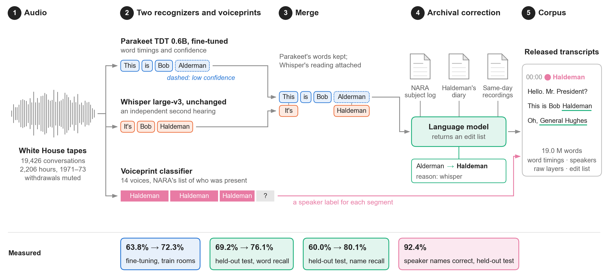

# The Nixon Corpus

*The Nixon Corpus: Speaker-Annotated Transcripts of the Nixon Tapes Using a Fine-Tuned Transformer Model* (Arvin Akoopie). Word-timed, speaker-annotated machine transcripts of the Nixon White House tapes, and the
code that made them. From February 16, 1971 to July 18, 1973 a secret taping system recorded 2,719 hours of
conversation. General-purpose speech recognition performs poorly on its concealed microphones. This project
fine-tunes NVIDIA Parakeet TDT 0.6B on the tapes, runs Whisper large-v3 as an independent second transcription,
reconciles the two with a language model (Gemini 4 Argon) against NARA's subject logs, H. R. Haldeman's diary and the
day's other conversations, and names fourteen principal speakers with a voiceprint classifier.

To our knowledge this is the first publicly documented speech recognizer fine-tuned on the Nixon tapes. The corpus
covers every conversation released as an individual recording: **19,426 conversations, 2,206 hours**, about 19
million words (release v1.1).

**Paper:** [`paper/arxiv/main.pdf`](paper/arxiv/main.pdf) (LaTeX source in [`paper/arxiv/`](paper/arxiv/)).
**Data card:** [`docs/DATA_CARD.md`](docs/DATA_CARD.md).
**Methods log (source of truth for every number):** [`docs/METHODS.md`](docs/METHODS.md).

## Headline results

Held-out test: 165 conversations transcribed by the State Department's historians for *Foreign Relations of the
United States*, which played no part in development (351,883 reference words; METHODS 7o). 95% intervals from 10,000
bootstrap resamples of conversations.

| Layer | Word recall | WER | Names |
|---|---|---|---|
| Whisper large-v3 alone | 69.2% [67.4, 70.7] | 42.0% | 60.0% |
| Fine-tuned Parakeet v5 alone | 73.7% [72.0, 75.1] | 38.1% | 60.2% |
| Released corpus (both recognizers + archival correction) | **76.1%** [74.5, 77.6] | **35.1%** | **80.1%** |

On six development room recordings the fine-tuned recognizer recovers 72.3% of words, against 63.8% for the stock
model and 64.6% for Whisper decoded sequentially (METHODS 7p). On the test conversations, 92% of the speaker names the
corpus assigns are correct (96% for the fourteen voices the classifier knows).

Whisper alone leaves model-specific artifacts that the second recognizer exposes: 2,613 repetition loops across the
corpus (Parakeet v5: 105), stretches of speech dropped by batched decoding (5.2% of Parakeet's words fall where
batched Whisper was silent for 20 s or more), and text produced over silence, such as 987 stock phrases like "thank you
for watching" (METHODS 7p).

## Pipeline



1. **Sources:** NARA's conversation manifest and audio, subject logs, and public-domain WSPF, House Judiciary
   Committee and NARA transcripts for training and validation; FRUS transcripts for the held-out test.
2. **Fine-tune Parakeet** in five rounds (v1-v5) on those transcripts and the author's own annotation.
3. **Transcribe** every conversation on rented GPUs: Parakeet (word timing, per-word confidence) and Whisper
   (an independent second transcription).
4. **Speakers:** a linear classifier on frozen speaker embeddings names the principal voices, restricted to the
   people NARA lists as present.
5. **Merge and correct:** the two transcripts are merged, and a language model returns edits informed by the
   archive, day by day. Every edit is marked and reversible.
6. **Explore:** a local web app for search, playback and reading.

## Data

Release **v1.1** (about 0.8 GB) is hosted at **[release DOI to be added]**, separately from this repository. It
contains, as described in [`docs/DATA_CARD.md`](docs/DATA_CARD.md):

| File | Contents |
|---|---|
| `nixon-corpus-v1.1-conversations-{1971,1972,1973}.tar` | one `<id>.json.gz` per conversation: words, timings, speakers, confidences, edit lists, turns |
| `nixon-corpus-v1.1-transcripts-txt.zip` | one readable `<id>.txt` per conversation, speaker turns with timestamps |
| `metadata.csv` | one row per conversation (date, NARA location and participants, duration, word count, correction status) |
| `uncorrected_conversations.csv` | the 6 conversations whose correction failed or never ran |
| `nixon-corpus-v1.1-raw-{1971,1972,1973}.tar` (optional) | raw Parakeet v5 and Whisper layers and speaker segments |
| `MANIFEST.json`, `SHA256SUMS`, `README.md`, `DATA_CARD.md` | checksums and documentation |

The release has 19,426 conversations, of which 17,343 have words in the final layer. `data/sample/` in this repository
holds twelve conversations in the same format. `src/export_release.py` builds the release. The fine-tuned model is at
https://huggingface.co/akoopie/nixon-parakeet-tdt-0.6b-v5 **[to be uploaded]**. The source recordings come from the
National Archives (NARA) and the Richard Nixon Presidential Library and Museum.

Reading one conversation:

```python
import gzip, json, tarfile
tar = tarfile.open("nixon-corpus-v1.1-conversations-1973.tar")
rec = json.load(gzip.open(tar.extractfile("871-004.json.gz")))
for text, start, end, speaker, conf, source, edit in rec["words"][:5]:
    print(start, speaker, text)
```

**Known issues:** six conversations are uncorrected (399-011 and five with only a Parakeet transcript), and the
corrector blanked 411 mostly very short conversations to `[unclear]`; the raw layers keep the original text (data card
section 6).

## Repository layout

```
src/            pipeline scripts (map: src/README.md); src/export_release.py builds the release;
                src/explorer/ is the browsing app
paper/arxiv/    the paper: LaTeX source (main.tex, metadata.tex, sections/), references.bib, figures/, Makefile
paper/          figure_data.py and make_figures.py (figures from measured outputs), figures/ (SVG, PDF, PNG)
docs/           METHODS.md (full methods log), DATA_CARD.md, environment-pod.txt (full pod freeze)
data/sample/    three example conversations in release format
requirements-*  pinned environments (local; GPU pod: Whisper/pyannote and NeMo/Parakeet)
environment-local.yml    conda environment for the local side
```

Audio, full transcripts, databases and model weights are not in this repository; see Data.

## Reproducing

**Environments.** Local or CPU: `pip install -r requirements-local.txt` (Python 3.11, ffmpeg on PATH).
GPU pods used two virtualenvs on `runpod/pytorch:1.0.2-cu1281-torch280-ubuntu2404` (Python 3.12,
RTX 4090 24 GB): `requirements-gpu-whisper.txt` (WhisperX + pyannote) and `requirements-gpu-nemo.txt`
(NeMo 3.0.0, Parakeet). Versions are pinned on purpose (METHODS 8). Set `NIXON_DATA` to the data root.

**Order** (details and settings in METHODS):

1. `ingest_manifest.py`, `acquire.py`, `subject_logs.py`, `validation.py`: sources and the validation set (METHODS 1-2).
2. `finetune_data.py`, `align_clips.py`, `finetune_parakeet.py`, and the annotation-round scripts
   (`select_windows.py`, `correction_session.py`, `hard_clips.py`, ...): fine-tuning (METHODS 4, 7d-7g). The v5 run is `round5k.sh`.
3. `corpus_v5.sh` with `worker.py`: transcribe the corpus on GPU pods (METHODS 6, 7h).
4. `voiceprints.py`, `name_speakers.py`: speakers (METHODS 5).
5. `merge.py`, `correct.py`, `argon.py` / `argon_run.py`: merge and correct (METHODS 7b-7l). Needs a Gemini API key.
6. `score.py`, `val_ci.py`, `frus_test.py`, `whisper_artifacts.py`: evaluation (METHODS 2, 7o, 7p).
7. `explorer/build.py`: the explorer database. `paper/figure_data.py` -> `paper/make_figures.py` -> `make -C paper/arxiv`:
   figures and paper.

**GPU needs and rough costs** (from METHODS; RTX 4090 at about US$0.89/hr on RunPod): a fine-tuning round costs under
US$10, and the v5 re-run of the corpus about US$8.60 (METHODS 7h). The archival correction over the conversations with
words cost about US$155 at batch prices, including pilots and tests (METHODS 7l). Run the whole chain on a CPU pod or
locally in a dry run before renting a GPU.

## Running the explorer locally

```bash
python src/explorer/build.py     # builds explorer.db under $NIXON_DATA/explorer (needs the corpus data)
python src/explorer/server.py    # then open the address it prints
```

The explorer plays audio from your own copy of the recordings. To fetch audio over SSH from another
machine, set `NIXON_AUDIO_HOST` to its ssh host name; otherwise point it at local files (see
METHODS 8b).

## Listen before quoting

These are machine transcripts. Even after correction, roughly one word in four is wrong or missing, and some wrong
words look plausible. Speaker labels are classifier output. Do not quote a passage, or attribute it to a person,
without listening to the tape. Word timings in the corpus point you to the exact place.

## License and citation

- **Transcripts, annotations and fine-tuned model weights:** CC BY 4.0 ([`LICENSE-DATA.md`](LICENSE-DATA.md)).
  Attribution means citing the paper and the release (see [`CITATION.cff`](CITATION.cff)).
- **Code:** MIT ([`LICENSE`](LICENSE)). If you build on it, please cite the paper.
- The source recordings, NARA's metadata and the government transcripts are public domain.

## Acknowledgments

The National Archives and Records Administration (NARA) and the Richard Nixon Presidential Library and Museum, whose
archivists preserved, reviewed, described and released the recordings.
